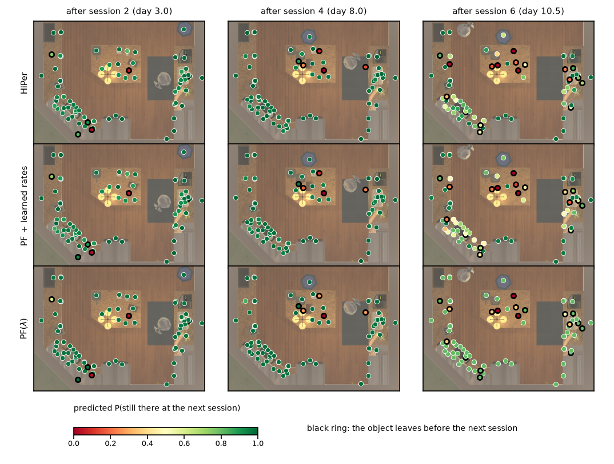

<p align="center">

  <h1 align="center">HiPer: Which Objects Stay?<br>Learning Hierarchical Persistence Beliefs for Lifelong Open-Vocabulary Object Maps</h1>
  <p align="center">
    <strong>Anonymous Authors</strong>
  </p>
  <p align="center"><strong>Submitted to IEEE Robotics and Automation Letters (RA-L), 2026</strong></p>
  <h3 align="center">Paper (coming soon) | <a href="./media/HiPer_video.mp4">Video</a> | <a href="#data">Data</a></h3>
  <div align="center"></div>
</p>
<p align="center">
    
</p>

<p align="center">
HiPer predicts which mapped objects will still be where they were last seen. Each dot is a mapped object, coloured by its predicted
probability of still being there at the next session; a black ring marks an object that actually leaves. Rows: HiPer, PF with learned
class rates, and Rosen's persistence filter PF(&lambda;), on the same THOR-Lifelong test scene.
</p>
<br>

<!-- TABLE OF CONTENTS -->
<details open="open" style='padding: 10px; border-radius:5px 30px 30px 5px; border-style: solid; border-width: 1px;'>
  <summary>Table of Contents</summary>
  <ol>
    <li><a href="#overview">Overview</a></li>
    <li><a href="#installation">Installation</a></li>
    <li><a href="#quick-start">Quick start</a></li>
    <li><a href="#data">Data</a></li>
    <li><a href="#reproduce-the-paper">Reproduce the paper</a></li>
    <li><a href="#results">Results</a></li>
    <li><a href="#ros-integration-experimental">ROS integration (experimental)</a></li>
    <li><a href="#repository-structure">Repository structure</a></li>
    <li><a href="#acknowledgement">Acknowledgement</a></li>
    <li><a href="#citation">Citation</a></li>
    <li><a href="#contact">Contact</a></li>
  </ol>
</details>

## Overview

HiPer is a **hi**erarchical **per**sistence filter for lifelong object maps:

- **Class level.** Class survival rates are learned from training scenes, keyed by zero-shot CLIP labels
  (interval-censored exponential fit with Gamma shrinkage).
- **Object level.** Each class rate becomes a conjugate Beta prior over the object's own survival rate. Both the
  rate and the object's presence are updated in closed form from in-view detections and misses.
- **Relocation.** When an object is re-identified somewhere else, its learned rate moves with it; only its presence
  restarts.

Objects are matched across sessions by DINOv2 appearance plus a Mahalanobis geometry term (Hungarian assignment).

We evaluate on two benchmarks:

- **THOR-Lifelong**, a new simulated benchmark (AI2-THOR, 60 scenes &times; 8 sessions) with exact ground truth.
- **ObChange**, real robot data (5 rooms, 26 visits).

## Installation

Tested on Ubuntu 20.04, Python 3.12, CUDA 12.8 and an RTX 4070 Ti. A GPU is needed only to extract CLIP/DINOv2
features and to render AI2-THOR scenes. Tuning, evaluation and the filter itself run on the CPU.

1. Clone the repository.
```bash
git clone https://github.com/pairs-lab/HiPer.git
cd HiPer
```

2. Create a Python 3.12 environment (we use [uv](https://github.com/astral-sh/uv); conda works too).
```bash
uv venv --python 3.12 .venv
source .venv/bin/activate
```

3. Install PyTorch for CUDA 12.8, then the pinned evaluation dependencies.
```bash
uv pip install torch==2.11.0 torchvision==0.26.0 --index-url https://download.pytorch.org/whl/cu128
uv pip install -r requirements-eval.txt
```
[requirements-eval.txt](requirements-eval.txt) pins the exact versions that produced the paper's numbers.
Two pins matter for correctness:
- **CLIP** must be built as `ViT-B-32-quickgelu` with the OpenAI weights. The plain `ViT-B-32` model uses the
  wrong activation.
- **numpy** must stay below 2.

4. Check the installation (268 tests, CPU only, about 5 s).
```bash
python -m pytest tests/ -q -p no:cacheprovider
```

The code is used straight from the source tree, without a pip install. Scripts register `src/` as the `hiper`
package through `tests/conftest.py`.

## Quick start

```python
import sys; sys.path.insert(0, "tests")
import conftest  # noqa: F401  (registers src/ as the `hiper` package)

from hiper.ephemerality.persistence_v2 import HIT, MISS, HierarchicalPersistenceFilter

DAY = 86400.0
hpf = HierarchicalPersistenceFilter(
    # class survival rates [1/s]; the paper learns them on training scenes
    lambda_table={"mug": 1 / (3 * DAY), "sofa": 1 / (365 * DAY)},
    kappa0=16, p_miss=0.1, p_false=0.01, tau_pi=0.3, variance_gate=False)

hpf.create("mug_1", "mug", t=0.0)
hpf.observe("mug_1", 0.0, HIT)          # first sighting
hpf.observe("mug_1", 1 * DAY, HIT)      # seen again next day
hpf.observe("mug_1", 2 * DAY, MISS)     # in view, not detected
print(f"P(still there, day 3) = {hpf.presence('mug_1', 3 * DAY):.3f}")   # 0.151
print(f"E[daily survival p]   = {hpf.rate_mean('mug_1'):.3f}")          # 0.705
print("prune?", hpf.should_prune("mug_1", 3 * DAY))                     # True
```

The parameters shown are the ones selected on the validation split (`kappa0=16`, `p_miss=0.1`, `p_false=0.01`,
`tau_pi=0.3`, no variance gate). Every baseline in the paper implements the same `PersistenceModel` interface:
[persistence_v2.py](src/ephemerality/persistence_v2.py), [persistence_baselines.py](src/ephemerality/persistence_baselines.py),
[persistence_pocd.py](src/ephemerality/persistence_pocd.py).

## Data

All data goes under `$HIPER_DATA` (default `~/lifelong_ws/data`):
```
$HIPER_DATA/hiper_thor/{raw,sessions,results,object_types.json}
$HIPER_DATA/obchange/{extracted,sessions}
```

### THOR-Lifelong (simulation)

The benchmark is generated with AI2-THOR 5.0.0 (CloudRendering, build `a9ccb07f`, downloaded automatically on first
use; it needs a Vulkan-capable GPU). It uses the RoomR scene split: 20 train, 20 validation and 20 test scenes,
each with 8 sessions. Objects move, appear and disappear according to their affordances.
```bash
# raw RGB-D sessions + ground truth (~6.3 GB; ~4.5 h on our shared machine)
for s in train val test; do python scripts/thor_generate_sessions.py --split $s --sessions 8 --jobs 3; done
# object tracks with CLIP + DINOv2 features -> sessions/<split>/<scene>/session_<kk>.npz (~725 MB)
python scripts/thor_extract_tracks.py --splits train val test --workers 6
```

### ObChange (real robot)

Download the [ObChange dataset](https://doi.org/10.48436/y3ggy-hxp10) (Langer et al., TU Wien, CC BY 4.0) and extract
it to `$HIPER_DATA/obchange/extracted/<Room>/<sceneN>/`. Then convert it:
```bash
python scripts/obchange_to_sessions.py   # oracle segmentation, rendered CLIP/DINOv2 views
```

## Reproduce the paper

Tuning is done on the validation split only. The test split and ObChange are each evaluated once.
```bash
python scripts/tune_and_eval.py tune           --run main   # association + every persistence family (val)
python scripts/tune_and_eval.py tune_classrate --run main   # class-rate learning on the selected association
python scripts/tune_and_eval.py tune_final     --run main   # freeze the configuration -> final.json
python scripts/tune_and_eval.py test           --run main --splits test obchange
python scripts/tune_and_eval.py loro           --run main   # ObChange leave-one-room-out
```

Tables, figures and video:
```bash
python paper/figures/make_result_tables.py --run main      # result tables + numbers quoted in the text
python paper/figures/make_data_numbers.py  --run main      # dataset statistics
python paper/figures/make_qualitative.py   --mode prob --rule-models ours pf --sessions 2 4 6
python paper/figures/make_belief_figure.py
python scripts/make_video.py --baseline pf
```

## Results

### THOR-Lifelong test (20 scenes)

Lower is better except AUROC. &dagger; marks a method that is significantly worse than HiPer
(paired bootstrap over scenes, 95% CI).

| Method | NLL &darr; | Brier &darr; | ECE &darr; | AUROC &uarr; |
|---|---|---|---|---|
| **HiPer (ours)** | **0.304** | **0.090** | 0.052 | **0.877** |
| PF, learned class rates | 0.320&dagger; | 0.095&dagger; | 0.060&dagger; | 0.858&dagger; |
| PF(&lambda;) [Rosen et al. 2016] | 0.350&dagger; | 0.099&dagger; | **0.049** | 0.778&dagger; |
| ELite-style scalar | 0.363&dagger; | 0.103&dagger; | 0.062 | 0.784&dagger; |
| POCD-style | 0.397&dagger; | 0.125&dagger; | 0.071&dagger; | 0.793&dagger; |
| HiPer, hand-set class prior | 0.406&dagger; | 0.113&dagger; | 0.099&dagger; | 0.857&dagger; |
| Fuse-then-decay | 0.865&dagger; | 0.253&dagger; | 0.324&dagger; | 0.774&dagger; |

Ablations (NLL): rate reset at relocation 0.314; pooled rate without class rates 0.322; hand-set prior with CLIP
labels 0.513.

### ObChange real robot (5 rooms): a negative result

| Method | NLL &darr;, tuned in simulation | NLL &darr;, leave-one-room-out |
|---|---|---|
| HiPer (ours) | 1.705 | 0.519 |
| PF, learned class rates | 1.906 | 0.529 |
| PF(&lambda;) | 2.613 | **0.429** |

Parameters tuned in simulation are miscalibrated on real data for every method; in that setting the best NLL
comes from the simple fuse-then-decay rule (0.594). With parameters calibrated on the
other rooms, the single-rate PF(&lambda;) predicts best. It beats HiPer in all 5 rooms (exact sign-flip test,
p = 0.0625). The full tables, with Brier, ECE, AUROC and association accuracy, are in the paper.

## ROS integration (experimental)

The repository is also a ROS Noetic catkin package. It contains an earlier online pipeline: VIO front end,
open-vocabulary segmentation, object re-ID and a long-term map manager. **This pipeline was not used for, or
evaluated in, the paper.**
```bash
cd ~/catkin_ws/src && ln -s /path/to/HiPer . && cd .. && catkin_make
roslaunch hiper hiper_desktop.launch session_id:=0        # Jetson: hiper_jetson.launch
```

## Repository structure

```
src/ephemerality/     HiPer filter (persistence_v2.py), baselines, class-rate learning (priors.py)
src/object_encoder/   cross-session association (association_v2.py)
src/evaluation/       THOR-Lifelong + ObChange adapters, mapping/replay, metrics, data paths (paths.py)
scripts/              data generation, tuning/evaluation, video
paper/figures/        table and figure generators
tests/                unit tests (pytest)
nodes/, launch/, msg/ ROS pipeline (experimental)
```

## Acknowledgement

We build on [AI2-THOR](https://ai2thor.allenai.org/) and the RoomR scene split
([Weihs et al., CVPR 2021](https://github.com/allenai/ai2thor-rearrangement)), the
[ObChange dataset](https://doi.org/10.48436/y3ggy-hxp10) (Langer et al.),
[OpenCLIP](https://github.com/mlfoundations/open_clip) and [DINOv2](https://github.com/facebookresearch/dinov2).
The persistence filter of Rosen et al. (ICRA 2016), and the POCD and ELite formulations, served as baselines.
Thanks to all authors for making their code and data public.

## Citation

If you find this work useful, please cite:
```bibtex
@misc{hiper2026,
  title  = {Which Objects Stay? Learning Hierarchical Persistence Beliefs for Lifelong Open-Vocabulary Object Maps},
  author = {Anonymous},
  note   = {Under review at IEEE Robotics and Automation Letters},
  year   = {2026}
}
```

## Contact

Please open a [GitHub issue](https://github.com/pairs-lab/HiPer/issues) for questions, comments and bug reports.
